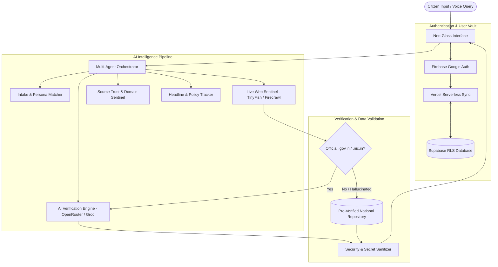

# 🇮🇳 YojanaMitra — Unified Central & State Welfare Intelligence Portal

[](https://react.dev/)
[](https://vitejs.dev/)
[](https://www.typescriptlang.org/)
[](https://opensource.org/licenses/MIT)
[](https://github.com/Shauryagupta4/YojnaMitra)

> **YojanaMitra** (योजनामित्र) is an AI-powered civic intelligence and welfare discovery engine connecting Indian citizens, students, farmers, women, and entrepreneurs with verified Central and State Government schemes, subsidies, and scholarships.

---

## 📑 Table of Contents
1. [Overview](#-overview)
2. [Key Features](#-key-features)
3. [Multi-Agent Architecture](#-multi-agent-architecture)
4. [Supported Citizen Personas](#-supported-citizen-personas)
5. [Tech Stack](#-tech-stack)
6. [Project Structure](#-project-structure)
7. [Security & Zero-Leak Protocol](#-security--zero-leak-protocol)
8. [Getting Started](#-getting-started)
9. [Environment Configuration](#-environment-configuration)
10. [Available Scripts](#-available-scripts)
11. [Deployment Guide](#-deployment-guide)

---

## 🌟 Overview

Navigating India's welfare landscape across 28 States, 8 Union Territories, and hundreds of Central Ministries is notoriously fragmented. Citizens frequently miss out on critical benefits due to complex eligibility rules, outdated portals, and lack of awareness.

**YojanaMitra** solves this by:
- Intelligently matching citizens to schemes based on demographic, income, domicile, and category criteria.
- Validating every opportunity against official government domains (`.gov.in`, `.nic.in`, `mygov.in`, `scholarships.gov.in`).
- Utilizing an orchestrated multi-agent AI pipeline for live verification, web scraping, and policy tracking.
- Providing instant bilingual voice assistance and an offline-resilient verified knowledge base.

---

## ⚡ Key Features

- 🎯 **Persona-Driven Eligibility Matching**: Specialized questionnaires for Students, Farmers, Women, Entrepreneurs, Senior Citizens, and General Citizens.
- 🤖 **Multi-Agent Search & Validation**: Integrates live deep web search with AI validation to detect current deadlines, application links, and official guidelines.
- 🛡️ **Anti-Hallucination & Domain Sentinel**: Strictly filters and verifies source URLs against authentic Indian government portals.
- 🔐 **Dual Authentication System**: 
  - One-click Google Sign-In powered by **Firebase Auth** (popup flow).
  - Secure profile synchronization and persistence via **Supabase Database** with Row Level Security (RLS).
- 🎙️ **Voice Search & Speech Synthesis**: Real-time voice query recognition and auditory guidance using the Web Speech API.
- 📢 **Live Policy Headlines Sentinel**: Tracks breaking government announcements, scheme revisions, and budget allocations in real-time.
- 💎 **Neo-Glass Design System**: High-contrast, responsive glassmorphic aesthetic built with Vanilla CSS for zero-overhead performance.
- 🚀 **Offline-First Fallback Engine**: Ships with an extensive catalog of pre-verified national and state welfare schemes that function even during network throttling or API downtime.

---

## 🧠 Multi-Agent Architecture

The discovery and verification lifecycle operates through coordinated micro-agents:



---

## 👥 Supported Citizen Personas

| Persona | Core Coverage & Target Schemes |
| :--- | :--- |
| 🎓 **Students & Scholars** | National Scholarship Portal (NSP), Pre/Post-Matric Grants, AICTE Pragati & Saksham, State Medhavi Chhatravritti, PM-USP, Domicile Fee Concessions. |
| 🌾 **Farmers & Agri-Workers** | PM-KISAN Samman Nidhi, Pradhan Mantri Fasal Bima Yojana (PMFBY), Kisan Credit Card (KCC), Solar Pump (KUSUM), Micro-Irrigation Subsidies. |
| 👩 **Women & Child Welfare** | Pradhan Mantri Matru Vandana Yojana (PMMVY), Sukanya Samriddhi Yojana (SSY), Lakhpati Didi, Ladli Behna, Mahila Samman Savings. |
| 💼 **Entrepreneurs & MSME** | PM Mudra Yojana (Shishu/Kishore/Tarun), Stand-Up India, PMEGP, Credit Guarantee Fund (CGTMSE), Startup India Seed Fund. |
| 👴 **Senior Citizens & Divyang** | Indira Gandhi National Old Age Pension, PM Vaya Vandana Yojana, Rashtriya Vayoshri Yojana, Divyangjan Swavlamban, Disability Aid. |
| 🏛️ **General & BPL Families** | Ayushman Bharat (PM-JAY), PM Awas Yojana (Urban/Gramin), PM Ujjwala Yojana, Antyodaya Anna Yojana (Ration Card). |

---

## 🛠️ Tech Stack

- **Frontend Core**: [React 19](https://react.dev/), [TypeScript 7](https://www.typescriptlang.org/)
- **Build & Bundler**: [Vite 8](https://vitejs.dev/)
- **Styling**: Vanilla CSS (Tailored HSL tokens, glassmorphism, responsive CSS grid)
- **Icons**: [Lucide React](https://lucide.dev/)
- **Authentication**: [Firebase 13](https://firebase.google.com/) (Client Auth) & [Supabase](https://supabase.com/) (Profiles & Persistence)
- **Live Search & Scraper**: [TinyFish Web Sentinel](https://tinyfish.ai/) & [@mendable/firecrawl-js](https://firecrawl.dev/)
- **AI Processing**: OpenRouter API (`openrouter/free` models) & Groq Cloud AI fallback
- **Linter**: [Oxlint](https://oxc.rs/)

---

## 📁 Project Structure

```text
YojnaMitra/
├── api/                             # Serverless backend functions (Vercel / Node)
│   ├── auth/
│   │   └── sync-google-user.ts     # Firebase-to-Supabase user sync endpoint
│   ├── lib/
│   │   ├── cache.ts                # In-memory query caching
│   │   ├── jurisdiction.ts         # Central vs State jurisdiction mapping
│   │   ├── openRouterProcessor.ts  # OpenRouter LLM completion pipeline
│   │   ├── sourceVerification.ts   # Government portal domain validation
│   │   ├── tinyfishSearch.ts       # TinyFish live web search client
│   │   └── validation.ts           # Zod schema checks
│   ├── headlines.ts                # Policy updates and breaking news endpoint
│   └── schemes/
│       └── search.ts               # Multi-agent live search & verification endpoint
├── public/
│   ├── favicon.svg                 # Application favicon
│   └── icons.svg                   # SVG icon sprite
├── src/
│   ├── components/
│   │   └── AuthPage.tsx            # Full-featured authentication & profile portal
│   ├── data/
│   │   └── schemes.ts              # Pre-verified national & state scheme repository
│   ├── services/
│   │   ├── firebaseClient.ts       # Singleton Firebase Google Auth service
│   │   ├── multiAgentOrchestrator.ts # Core search, intake & eligibility orchestrator
│   │   ├── securitySanitizer.ts    # Client-side log & secret scrubbing
│   │   └── supabaseClient.ts       # Supabase client initialization
│   ├── types/
│   │   └── scheme.ts               # Scheme, Persona, and Citizen TypeScript types
│   ├── App.tsx                     # Main application layout, filters & UI state
│   ├── index.css                   # Global Neo-Glass design system
│   └── main.jsx                    # Application entry point
├── .env.example                     # Environment template (NO real secrets)
├── .gitignore                       # Git exclusions for secrets and build artifacts
├── package.json                     # Project scripts and dependencies
├── tsconfig.json                    # TypeScript compiler configuration
└── vite.config.js                   # Vite configuration
```

---

## 🔒 Security & Zero-Leak Protocol

Security of citizen data and API credentials is fundamentally enforced across the repository:

1. **Strict Git Exclusion**:
   - `.env`, `.env.*`, and all local environment variants are permanently excluded in [`.gitignore`](file:///.gitignore).
   - Only [`.env.example`](file:///.env.example) with generic placeholders is committed.
2. **No Hardcoded Fallbacks**:
   - All client and server services read strictly from environment variables (`import.meta.env` or `process.env`) with empty fallbacks (`|| ''`).
3. **Telemetry & Log Scrubbing**:
   - [`src/services/securitySanitizer.ts`](file:///src/services/securitySanitizer.ts) automatically intercepts and redacts API keys, Bearer tokens, and sensitive headers before any message can reach the browser console.
4. **Serverless Secret Isolation**:
   - High-privilege API keys (`TINYFISH_API_KEY`, `OPENROUTER_API_KEY`, `SUPABASE_SECRET_KEY`) reside exclusively in serverless backend functions (`/api/`) and are never bundled into the client browser application.

---

## 🚀 Getting Started

### Prerequisites
- **Node.js**: v18.0.0 or higher
- **npm**: v9.0.0 or higher

### Installation

1. **Clone the repository**:
   ```bash
   git clone https://github.com/Shauryagupta4/YojnaMitra.git
   cd YojnaMitra
   ```

2. **Install dependencies**:
   ```bash
   npm install
   ```

3. **Configure Environment Variables**:
   ```bash
   cp .env.example .env
   ```
   Open `.env` in your editor and enter your API keys.

4. **Launch the development server**:
   ```bash
   npm run dev
   ```
   Open [http://localhost:5173](http://localhost:5173) in your browser.

---

## ⚙️ Environment Configuration

Refer to [`.env.example`](file:///.env.example) for the full list of options:

```ini
# ==============================================================================
# TinyFish Web Sentinel (https://tinyfish.ai)
# ==============================================================================
TINYFISH_API_KEY=your_tinyfish_api_key_here

# ==============================================================================
# OpenRouter Free LLM API (https://openrouter.ai)
# ==============================================================================
OPENROUTER_API_KEY=your_openrouter_api_key_here
OPENROUTER_MODEL=openrouter/free

# ==============================================================================
# Firebase Google Authentication (https://console.firebase.google.com)
# ==============================================================================
VITE_FIREBASE_API_KEY=your_firebase_api_key
VITE_FIREBASE_AUTH_DOMAIN=your-project.firebaseapp.com
VITE_FIREBASE_PROJECT_ID=your-project-id
VITE_FIREBASE_STORAGE_BUCKET=your-project.firebasestorage.app
VITE_FIREBASE_MESSAGING_SENDER_ID=your_sender_id
VITE_FIREBASE_APP_ID=your_app_id
VITE_FIREBASE_MEASUREMENT_ID=your_measurement_id

# ==============================================================================
# Supabase Database & User Sync (https://supabase.com)
# ==============================================================================
VITE_SUPABASE_URL=https://your-project.supabase.co
VITE_SUPABASE_ANON_KEY=your_supabase_anon_key
SUPABASE_SECRET_KEY=your_supabase_service_role_key
```

> [!TIP]
> **Zero-Config Exhibition Mode:** Even without live API keys, the application launches smoothly and serves fully verified national schemes from the local dataset.

---

## 📜 Available Scripts

| Command | Purpose |
| :--- | :--- |
| `npm run dev` | Starts the Vite local development server with hot module replacement. |
| `npm run build` | Builds the production bundle into `/dist` with tree-shaking and minification. |
| `npm run preview` | Runs a local web server to preview the production build. |
| `npm run typecheck` | Executes TypeScript type checking (`tsc --noEmit`) across all modules. |
| `npm run lint` | Runs fast Oxlint static analysis across the codebase. |

---

## 🌐 Deployment Guide

### Deploying to Vercel

YojanaMitra is pre-configured for seamless deployment on **Vercel**:

1. Push your code to your GitHub repository.
2. Import the repository in your [Vercel Dashboard](https://vercel.com/new).
3. Under **Project Settings -> Environment Variables**, add the environment variables defined in your `.env`.
4. Click **Deploy**. Vercel will automatically build the client bundle and deploy the serverless functions in `/api`.

---

## 🤝 Contributing

Contributions are welcome! Please follow these steps:
1. Fork the repository.
2. Create your feature branch (`git checkout -b feature/NewSchemeSupport`).
3. Commit your changes (`git commit -m 'feat: add support for new state scholarship'`).
4. Push to the branch (`git push origin feature/NewSchemeSupport`).
5. Open a Pull Request.

---

## 📄 License

Distributed under the **MIT License**. See `LICENSE` for more information.
