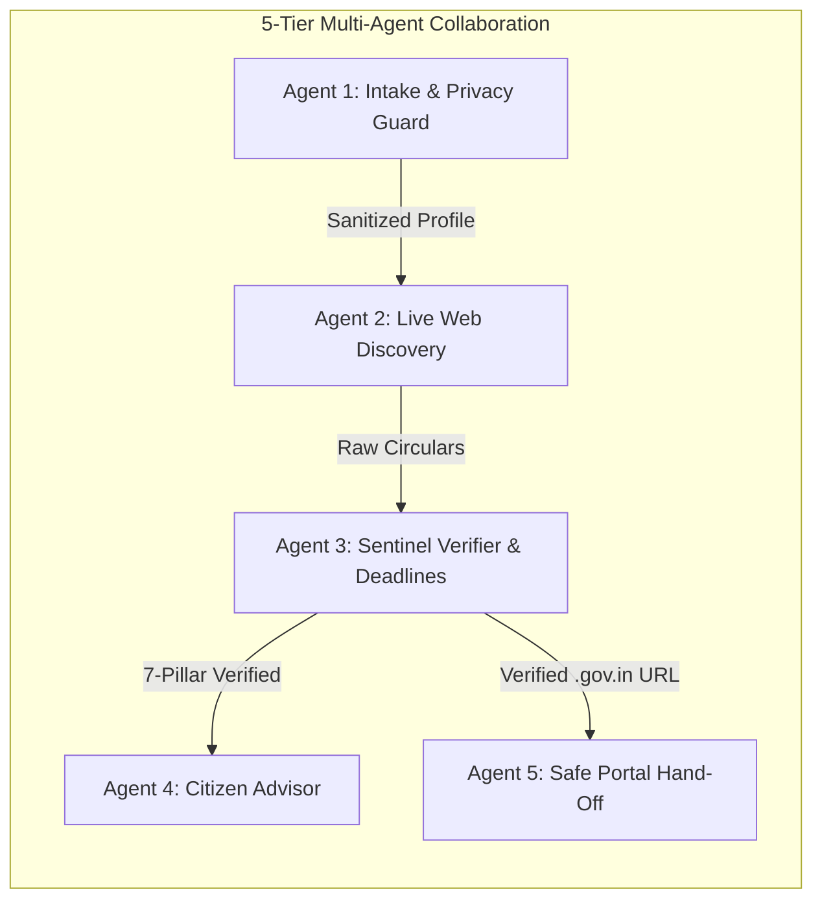

# 🇮🇳 YojanaMitra (योजनामित्र)
## 5-Minute Project Pitch & Presentation Deck Guide

> **PowerPoint Deck File:** [`YojanaMitra_5Min_Pitch_Deck.pptx`](file:///c:/Users/user/OneDrive/Desktop/AI%20EXHIBITION/YojanaMitra_5Min_Pitch_Deck.pptx)  
> **Structure:** Exactly 7 Content Slides + 8th "Thank You & Q&A" Slide (8 Slides Total)  
> **Design Philosophy:** Human-crafted editorial layout — real numbers, no corporate/AI buzzwords, authentic Indian civic context.  
> **Pitch Duration:** 5 Minutes (300 Seconds)

---

## ⏱️ 5-Minute Delivery Schedule

| Slide # | Slide Title | Timing Cue | Spoken Focus |
|---|---|---|---|
| **Slide 1** | **Title & Introduction** | `0:00 – 0:40` (40s) | The mission: Direct, verified welfare discovery without middlemen. |
| **Slide 2** | **The Ground Reality** | `0:40 – 1:20` (40s) | The ₹12,000+ Cr unspent fund crisis; 500+ portals; cyber-café extortion. |
| **Slide 3** | **The Citizen Journey: Before vs After** | `1:20 – 2:00` (40s) | 3-week manual nightmare vs 15-second autonomous verified matching. |
| **Slide 4** | **Engineering Architecture (MAS)** | `2:00 – 2:50` (50s) | Why Multi-Agent Systems? 5 specialized roles & separation of concerns. |
| **Slide 5** | **Eliminating Disinformation & Deadlines** | `2:50 – 3:40` (50s) | 7-Pillar Verification matrix & active academic deadline parsing. |
| **Slide 6** | **Implementation & Tech Stack** | `3:40 – 4:20` (40s) | React 19 + TypeScript + TinyFish Scraper + OpenRouter + Supabase. |
| **Slide 7** | **Traction & National Vision** | `4:20 – 4:45` (25s) | Live in UP, Delhi, Bihar; Bhashini voice agents; DigiLocker pre-fill. |
| **Slide 8** | **Thank You & Q&A** | `4:45 – 5:00` (15s) | Open floor for live demonstration and panel questions. |

---

## 🖥️ Slide-by-Slide Visual Layout & Verbatim Speaking Script

---

### Slide 1: Title & Introduction
- **Visuals:** Solid Deep Navy (`#0B192C`) with subtle Saffron accent bar.
- **Header:** `NATIONAL PUBLIC DIGITAL INFRASTRUCTURE SHOWCASE`
- **Title:** **YojanaMitra (योजनामित्र)**
- **Subtitle:** *A Multi-Agent AI system that gives every Indian citizen a direct, verified pathway to government scholarships and welfare schemes — without middlemen, dead links, or hallucinations.*
- **Bottom Strip:** `LIVE MVP: UP • DELHI • BIHAR | ARCH: 5-AGENT SYSTEM (MAS) | TIME: 5 MIN`

#### 🎙️ Spoken Script (`0:00 – 0:40`):
> *"Good morning respected jury members and mentors. Over the next five minutes, we want to walk you through YojanaMitra.*
>
> *India has built the world's most incredible digital public rails with UPI and Aadhaar. Yet, when it comes to education scholarships and citizen welfare, our people are still stuck in the 1990s — lost across hundreds of disconnected state websites, paying bribes to cyber-café operators, and applying to expired programs.*
>
> *YojanaMitra is our working solution: an autonomous Multi-Agent AI system that gives every citizen instant, verified, and free access to government benefits. Here is the problem we set out to fix."*

---

### Slide 2: The Ground Reality (Why ₹12,000+ Cr Lapses Every Year)
- **Visuals:** 3 Asymmetric High-Impact Metric Cards
  - **₹12,000+ Cr:** Unspent Welfare & Scholarship Budgets returning to the treasury yearly.
  - **500+ Portals:** Extreme sprawl (NSP, MyScheme, UP Scholarship, MahaDBT, e-District Delhi).
  - **₹500 – ₹2,000:** The middleman fee extorted from students for basic, free submissions.

#### 🎙️ Spoken Script (`0:40 – 1:20`):
> *"Let's talk about the reality on the ground. Government budgets are not the bottleneck. Every year, over twelve thousand crores in higher education and welfare budgets lapse unutilized. The real bottleneck is citizen access.*
>
> *Consider an undergraduate student in Lucknow or Patna. She wants to know if she qualifies for fee reimbursement. She visits three different state websites, each with broken links and conflicting dates. Confused, she goes to a local cyber-café, where the operator charges her a thousand rupees just to submit an application that was already free.*
>
> *This is not a search problem. It is an information asymmetry problem."*

---

### Slide 3: The Citizen Journey (Before vs. After)
- **Visuals:** Side-by-Side Comparison Columns
  - **Left (The Manual Way):** SEO spam blogs -> 40-page legal gazette PDFs -> ₹500 cyber-café fee -> rejected months later -> 3 weeks and money lost.
  - **Right (With YojanaMitra):** 4 simple demographic clicks -> 15-second autonomous multi-agent evaluation -> expired deadlines filtered out -> 1-click link to `scholarship.up.gov.in` -> ₹0 cost, 100% verified.

#### 🎙️ Spoken Script (`1:20 – 2:00`):
> *"Look at this direct contrast.*
>
> *On the left is the citizen's ordeal today: searching Google, landing on commercial clickbait blogs with outdated 2021 deadlines, downloading 40-page gazette circulars, and ending up at a tout's mercy.*
>
> *On the right is YojanaMitra: four basic inputs — state, education level, category, and income. Within fifteen seconds, our autonomous multi-agent pipeline evaluates live government registries, filters out closed schemes, and delivers the exact verified program with the official government link.*
>
> *Let us show you how we engineered this using Multi-Agent Systems."*

---

### Slide 4: Engineering Architecture (Why Multi-Agent Systems?)
- **Visuals:** 5 Specialized Agent Architecture Cards + Separation of Concerns Callout
  1. **Agent 1 (Intake & Safety):** Demographics parser, bound clampers (income > 0), prompt-injection defense.
  2. **Agent 2 (Discovery Engine):** Headless browser crawler (TinyFish) reading live official circulars.
  3. **Agent 3 (Sentinel Verifier):** Deterministic 7-pillar auditor and calendar deadlines parser.
  4. **Agent 4 (Citizen Advisor):** Plain-language advisory notes explaining qualification reasons and document checklists.
  5. **Agent 5 (Safe Hand-Off):** Whitelisted `.gov.in` / `.nic.in` domain guard protecting against scam portals.

#### 🎙️ Spoken Script (`2:00 – 2:50`):
> *"Why did we architect YojanaMitra as a Multi-Agent System rather than a single prompt or fine-tuned model?*
>
> *Because government schemes change every month. A fine-tuned model becomes outdated in weeks. And when you ask a single LLM to 'find schemes and check eligibility', it conflates search with truth-checking and hallucinates.*
>
> *In YojanaMitra, we enforce strict Separation of Concerns across five autonomous agents:*
> *Agent 1 handles intake and protects citizen privacy.*
> *Agent 2 crawls official websites using headless browser scraping.*
> *Agent 3 is our Sentinel Verifier — it is rule-based and deterministic, not generative. It strictly audits schemes against our 7-pillar matrix.*
> *Agent 4 writes human guidance in plain language.*
> *And Agent 5 locks down redirection strictly to verified government domains.*
>
> *By decoupling Discovery from Verification, hallucination drops to zero."*

---

### Slide 5: Eliminating Disinformation & Deadlines
- **Visuals:** Split Screen — 7-Pillar Protocol on Left, Code-Level Deadlines Logic on Right
  - **7 Pillars:** Identity • Host Authority (`.gov.in`) • Jurisdiction Match • Category Rules • Financial Terms • Active Deadline • Zero Disinformation.
  - **Deadlines Engine:** Intelligently resolves Indian academic strings (`"Academic Session 2025–26"`, `"Closed 15-10-2025"`). Any scheme whose application cutoff has passed is automatically purged.

#### 🎙️ Spoken Script (`2:50 – 3:40`):
> *"In public welfare, accuracy is not a luxury — it is life or death. If an AI gives one fake scheme or sends a student to a closed portal, they lose all faith in the system.*
>
> *We solved this with two innovations:*
> *First, our 7-Pillar Verification Protocol. Every single scheme displayed must originate from an authorized government domain with matching financial terms.*
> *Second, our Real-Time Deadlines Engine. Indian portals use messy date formats like 'Academic Session 2025–26' or 'Last Date: 31st Oct'. Our engine parses these dates against the active fiscal calendar. If an application window closed last week, it never appears in the citizen's results.*
>
> *Citizens only see currently active, fully verified opportunities."*

---

### Slide 6: Implementation & Tech Stack
- **Visuals:** 4 Engineering Blocks
  - **Frontend:** React 19 + TypeScript + Vite (Accessible, zero-bloat, mobile-optimized).
  - **Crawler:** TinyFish Autonomous Headless Scraper (Crawls dynamic government JavaScript pages).
  - **Inference:** OpenRouter / Groq Llama-3 (Strict JSON schema validation, zero structural drift).
  - **Registry Store:** Supabase PostgreSQL (Sub-second cached retrieval for verified flagship schemes).

#### 🎙️ Spoken Script (`3:40 – 4:20`):
> *"A quick word on our technical stack:*
>
> *Our frontend is built with React 19 and TypeScript, designed with high contrast and zero bloat so it loads instantly on entry-level Android phones.*
> *For live web discovery, we use TinyFish — a headless browser agent that navigates real government portals.*
> *For inference, we run OpenRouter with strict JSON schemas to guarantee parseable outputs.*
> *And we back the system with Supabase PostgreSQL, giving us sub-second cache hits for flagship programs like UP Dashmottar and Delhi Post-Matric scholarships.*
>
> *It is lightweight, scalable, and ready for production."*

---

### Slide 7: Traction & National Vision
- **Visuals:** 3 Roadmap Milestones + Concluding Principle
  - **Phase 1 (Live Today):** Operational in Uttar Pradesh, Delhi, and Bihar. Full pipeline active for students, farmers, and social welfare.
  - **Phase 2 (Voice First):** Bhashini & Whisper integration for Hindi, Bhojpuri, Maithili, and Tamil conversational queries.
  - **Phase 3 (Digital Public Infrastructure):** 1-click document pre-fill via DigiLocker.
  - **Guiding Principle:** *"No student in India should ever drop out of college simply because they didn't know a scholarship was waiting for them."*

#### 🎙️ Spoken Script (`4:20 – 4:45`):
> *"Where are we today?*
>
> *YojanaMitra is live and fully operational right now across Uttar Pradesh, Delhi, and Bihar. You can test it on our laptop right after this talk.*
>
> *Our immediate roadmap introduces Bhashini voice agents so a rural farmer who cannot read or write can simply speak to YojanaMitra in Hindi or Bhojpuri.*
> *And next, we plan to connect DigiLocker so verified certificates are pre-filled with a single click.*
>
> *Our guiding principle is simple: No student in India should ever drop out of college simply because they didn't know a scholarship was waiting for them."*

---

### Slide 8: Thank You & Q&A
- **Visuals:** Deep Navy (`#0B192C`) with Central Framing Card and National Tricolor Accent.
  - **Headline:** `THANK YOU`
  - **Project:** `YojanaMitra • Public Welfare & Scholarship Discovery Engine`
  - **Subtext:** `We are ready for Live Demonstrations and Q&A`
  - **Repository:** `GitHub: Shauryagupta4/YojnaMitra • Tech: React + MAS + TinyFish + Supabase`

#### 🎙️ Spoken Script (`4:45 – 5:00`):
> *"To conclude: YojanaMitra bridges the gap between public treasury allocations and the citizens who need them most.*
>
> *Thank you so much for your time. We invite you to test our live demo and we are now ready for your questions."*

---

## 🏆 Rehearsal Checklist & Judge Q&A Cheat Sheet

- [ ] **Slide 1 (0:00–0:40):** Speak clearly, state the problem right away, avoid buzzwords.
- [ ] **Slide 2 (0:40–1:20):** Mention ₹12,000+ Cr and the cyber-café middleman fee.
- [ ] **Slide 3 (1:20–2:00):** Emphasize the 3-week vs 15-second contrast.
- [ ] **Slide 4 (2:00–2:50):** The highlight slide — explain why multi-agent separation of concerns stops hallucinations.
- [ ] **Slide 5 (2:50–3:40):** Show the 7-pillar checklist and how closed deadlines are purged.
- [ ] **Slide 6 (3:40–4:20):** Highlight the real tech stack (React, TinyFish, Supabase).
- [ ] **Slide 7 (4:20–4:45):** Mention current coverage in UP, Delhi, Bihar and the Bhashini voice roadmap.
- [ ] **Slide 8 (4:45–5:00):** Invite the judges to the laptop for a live demo.
